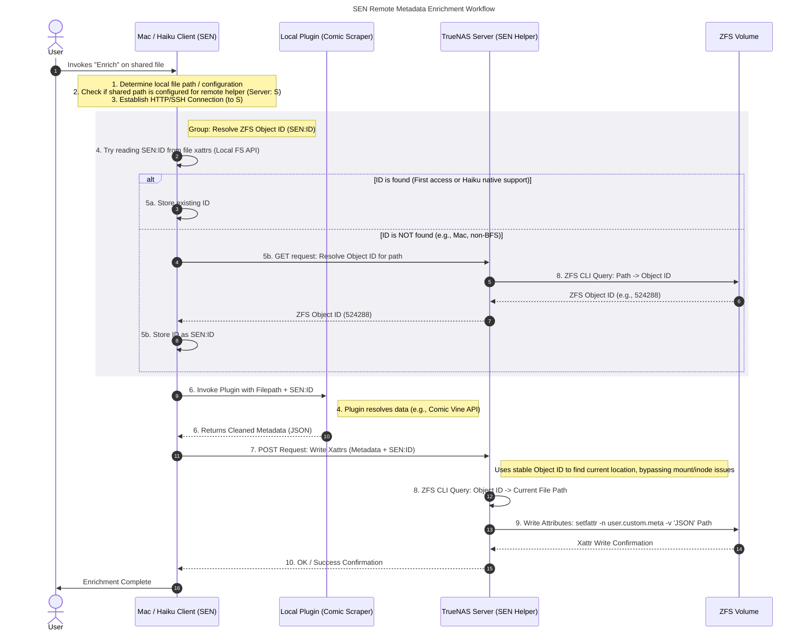

<div style="align-content: center">
    
</div>

# 🌉 BASHI: Bridge for Advanced SEN Host Integration

**A microservice bridge to restore native file metadata capabilities in distributed, ZFS-based environments.**

-----

## 🎯 Project Purpose and Context

**BASHI** (Japanese for "bridge") is a critical infrastructure component designed for the **S**emantic **E**nrichment **N**etwork (**SEN**) ecosystem.

Modern containerized file servers, such as those deployed on **TrueNAS SCALE** (using ZFS and Docker), often strip away or make proprietary file system features like **extended attributes (xattrs)** inaccessible over standard network protocols (NFS, SMB).

BASHI solves this by providing a dedicated, secure **HTTP bridge** to perform metadata operations directly on the ZFS host, using the ZFS kernel utilities and leveraging stable, unique ZFS identifiers.

**Why BASHI is Necessary:**

  * **Semantic Integrity:** It allows SEN (running on clients like macOS or Haiku) to store rich, structured metadata (as JSON) directly with the files on the ZFS volume, ensuring data portability and decoupling metadata from centralized databases.
  * **NFS/SMB Limitation:** It bypasses the limitations of network file systems, which often prevent clients from reliably reading or writing custom `user.*` extended attributes.
  * **ZFS Stability:** It replaces brittle, transient file identifiers (like the POSIX inode) with the **stable, persistent ZFS Object ID**, guaranteeing that the metadata written always links back to the intended file, even if the file is moved or the system reboots.

| Component               | Default Behavior                                                                                                                | SEN Solution                                                                                                 |
|-------------------------|---------------------------------------------------------------------------------------------------------------------------------|--------------------------------------------------------------------------------------------------------------|
| Shared Drive (CIFS/NFS) | Metadata (xattrs) is often unreliable or inaccessible via the network protocol, and inode numbers change on reboots/reconnects. | Use ZFS's stable, queryable object ID as the persistent, semantic identifier instead of the transient inode. |
| Xattr Writing           | Requires local access to the file system (the server).                                                                          | A ""Helper Script"" on the remote server acts as a trusted local agent to write the xattrs.                  |

-----

## 🏗️ Technical Design: The Semantic Bridge

BASHI acts as a secure intermediary between the client application (SEN) and the ZFS host.

### **BASHI Workflow Overview**

The interaction between the client and BASHI follows a two-step process:

1.  **Resolution (Path $\rightarrow$ ID):** The SEN client sends the file path (as seen by the server) to BASHI. BASHI uses ZFS tools (`zfs get`, `zdb`) to resolve this path to the file's permanent **Object Set ID** and **Object ID**.
2.  **Operation (ID $\leftrightarrow$ Data):** The SEN client uses the stable ZFS IDs to request the reading or writing of extended attributes. BASHI uses the stable IDs to perform the inverse lookup (`zfs_ids_to_path`) and executes the `getfattr`/`setfattr` commands to manage the metadata.

This design ensures that file access is always mediated by a stable identifier, fulfilling the semantic integrity requirements of the SEN project.

### Conceptual Workflow



-----

## 🐍 Prerequisites and Shell Commands (Technical Background)

The BASHI helper service is a thin wrapper around essential low-level Linux/ZFS tools. Successful operation within a Docker container requires these utilities to be present and executable.

| Action | API Endpoint | Underlying Shell Command | Purpose |
| :--- | :--- | :--- | :--- |
| **Path $\rightarrow$ IDs** | `/api/bashi/resolve` (GET) | `zfs get objsetid <dataset>` + `zdb -dddd <path>` (Requires privileged access) | Resolves the file path to the stable ZFS Object Set ID and Object ID. |
| **ID $\rightarrow$ Path** | (Internal) | `zfs_ids_to_path <pool> <objset-id> <object-id>` | Guarantees the ID maps to the correct file path, regardless of renames/moves. |
| **Read Xattrs** | `/api/bashi/read` (GET) | `getfattr -d -m user. <file_path>` | Retrieves all custom `user.*` extended attributes. |
| **Write Xattr** | `/api/bashi/write` (POST) | `setfattr -n <name> -v <value> <file_path>` | Writes JSON-serialized metadata into a file's xattrs. |

-----

## 🐳 Deployment: TrueNAS SCALE Configuration

BASHI is deployed as a Docker container (Custom App) on your NAS, e.g. TrueNAS SCALE.
Due to its privileged access requirements, specific configuration steps are necessary.

### Requirements (`.env`)

BASHI requires the following configuration variables to be passed via the Docker environment:

| Variable | Description | Example |
| :--- | :--- | :--- |
| `ZFS_POOL_NAME` | The top-level name of the ZFS pool holding the data. | `mypool` |
| `ZFS_SERVER_MOUNT_ROOT` | The absolute path on the **host** where the target volume is mounted. **Must match the Docker volume map source.** | `/mnt/mypool/mydataset` |
| `BASHI_PORT` | The port the service listens on. | `5001` |

### Docker Compose (Custom App YAML)

When deploying, your `docker-compose.yml` for the BASHI service **must** meet the following non-standard requirements:

```yaml
services:
  bashi:
    image: your-registry/bashi-helper:latest # Replace with your image
    container_name: bashi
    ports:
      - "5001:5001"
    volumes:
      # CRITICAL: Mount the entire host directory tree BASHI needs to access
      - /mnt/mypool/mydataset:/mnt/mypool/mydataset # Use the absolute server path as the container path
    environment:
      # Pass configuration to the script
      - ZFS_POOL_NAME=mypool
      - ZFS_SERVER_MOUNT_ROOT=/mnt/mypool/mydataset
      # Add other environment variables here...
    
    # 💥 ABSOLUTE NECESSITY FOR ZFS TOOLS 💥
    privileged: true # Allows access to ZFS kernel interfaces and root commands like zdb
    pid: host      # Optionally, to ensure access to host processes and filesystem root
    restart: unless-stopped
```

### Permissions

The user running the BASHI container must have read and write access to the target files and read access to the ZFS internal utilities. Setting the container to `privileged: true` and mounting the data correctly usually grants the necessary access to execute ZFS and xattr commands.
